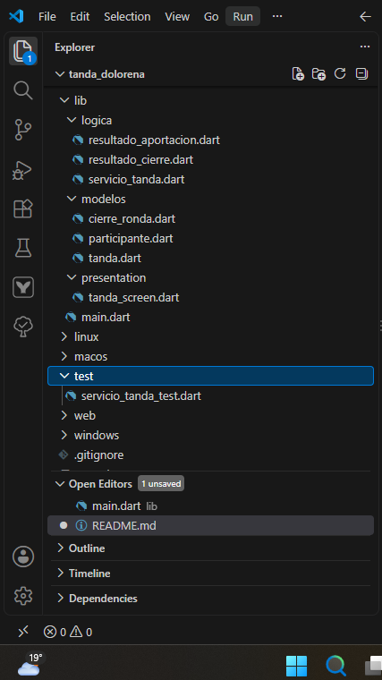
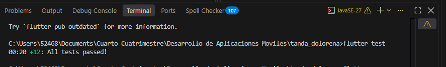
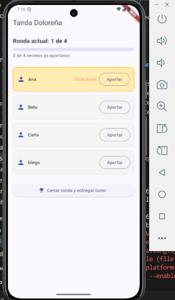
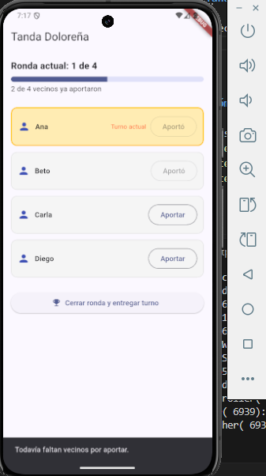
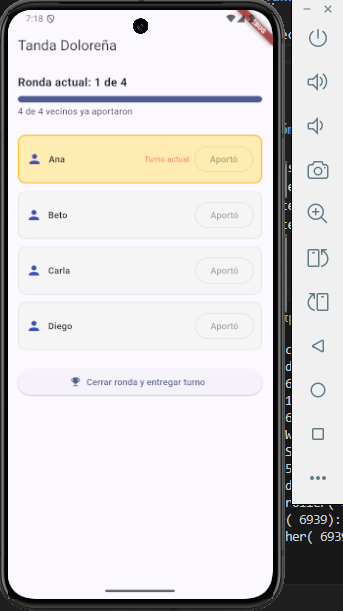
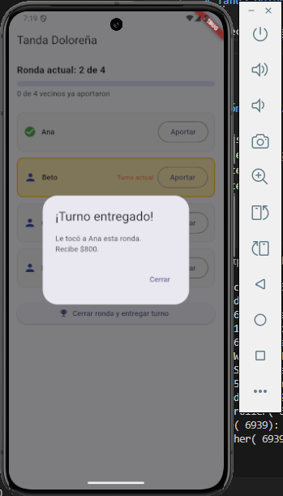
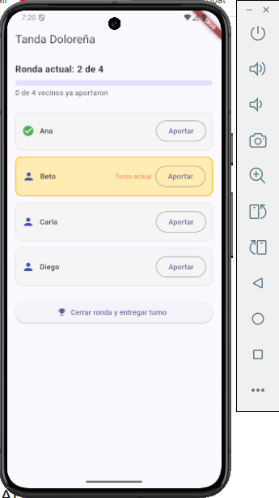
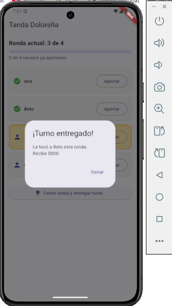
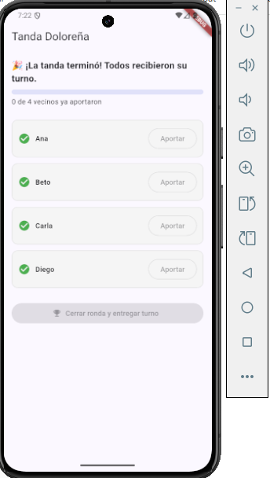

# Tanda Doloreña — Evidencias de funcionamiento (TDD)

Proyecto de ahorro rotativo vecinal (tanda) en Flutter, construido con TDD.

## Cómo ejecutar

```bash
flutter pub get
flutter test      # pruebas de lógica
flutter run       # app en el emulador
```

## Reglas de negocio protegidas

1. Cada participante aporta como máximo una vez por ronda.
2. Solo puede aportar quien pertenece a la tanda.
3. La ronda solo se cierra cuando todos aportaron.
4. Al cerrar, el turno va a quien corresponde según el orden acordado y se avanza.
5. Al terminar la tanda no se aceptan más aportaciones.

---

## Parte A — Pruebas

### 1. Estructura del proyecto
Carpetas `lib/` (`logica`, `modelos`, `presentation`, `main.dart`) y `test/`.



### 2. `flutter test` en verde
Todas las pruebas pasan (12 en total).



---

## Parte B — App en el emulador

### 4. Pantalla inicial
Ronda 1 de 4, barra en 0 y Ana resaltada como turno actual.



### 5. Aportaciones parciales
Ana y Beto ya aportaron; la barra avanza al 50 %.


### 6. No se puede cerrar la ronda sin todas las aportaciones
Aviso "Todavía faltan vecinos por aportar."



### 7. Ronda completa
Los 4 vecinos aportaron.



### 8. Animación del beneficiario
Diálogo "¡Turno entregado!" al cerrar la ronda.



### 9. Ronda 2
El turno avanzó: Ana con ✓ y Beto como turno actual.



### 10. Ronda 3 — beneficiario
Se respeta el orden de turnos.



### 11. Tanda terminada
Todos recibieron su turno y los botones quedan deshabilitados.



---

## Checklist del proyecto

- [x] Cada regla de negocio tiene su propia prueba
- [x] El orden de turnos se respeta exactamente como fue definido
- [x] La tanda rechaza aportaciones después de terminar
- [x] La interfaz no decide quién recibe el turno; se lo pregunta a `ServicioTanda`
- [x] La prueba de integración recorre una tanda completa

## Estructura

```
lib/
  modelos/        participante.dart, tanda.dart, cierre_ronda.dart
  logica/         resultado_aportacion.dart, resultado_cierre.dart, servicio_tanda.dart
  presentation/   tanda_screen.dart
  main.dart
test/
  servicio_tanda_test.dart
capturas/         evidencias
```
